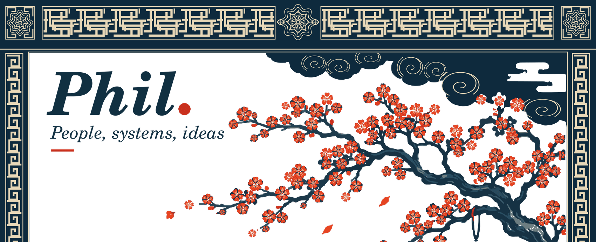
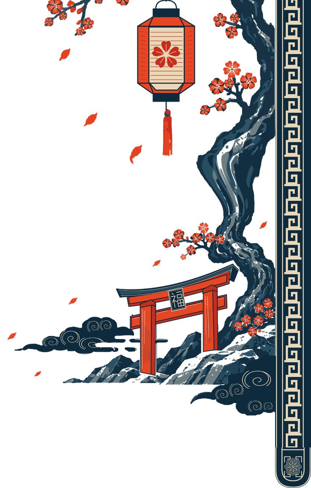

<picture><source media="(prefers-color-scheme: dark)" srcset="assets/top-dark.png"></picture>
<picture><source media="(prefers-color-scheme: dark)" srcset="assets/left-dark.png"></picture><picture><source media="(prefers-color-scheme: dark)" srcset="assets/right-dark.png"></picture>

### I'm Phil. This is what happens after "one last thing."

By day, I make **organisations, teams and systems** talk to each other.

I come from systems and networks. I like joining the dots between technical decisions, the people making them, and what they're trying to get done.

After hours, I write and build the things I wish existed.

> *I grew up believing knowledge should be free. Writing and open source are two ways I try to put that into practice.*

**[Say hello →](mailto:3yellowlabel@gmail.com)**

 

<em/>I'm not a developer. But the code doesn't know that.</em>

 

<table>
<tr>
<td width="50%" valign="top">

WRITING

### [Network Caffè](https://www.netcaffe.biz/)

I write about technology, infrastructure and digital culture: how things work, and what they mean for the people around them.

[*Read the magazine →*](https://www.netcaffe.biz/)

</td>
<td width="50%" valign="top">

CODE

### [Repositories](https://github.com/Phil-pje?tab=repositories)

Small, local-first tools I build after hours. The pinned ones are right below; the rest, experiments included, is one click away.

[*Browse all repositories →*](https://github.com/Phil-pje?tab=repositories)

</td>
</tr>
</table>

<em>MIT projects: take them, break them, make them better. AGPL projects: open to read and learn from, not to resell as a service.</em>

#### *Infrastructure & systems*

   

#### *Tool building*

     

<!-- Pac-Man dei contributi: per riattivarlo togli il commento (il workflow lo aggiorna da solo)
<picture>
  <source media="(prefers-color-scheme: dark)" srcset="https://raw.githubusercontent.com/Phil-pje/Phil-pje/output/pacman-contribution-graph-dark.svg">
  
</picture>
-->
